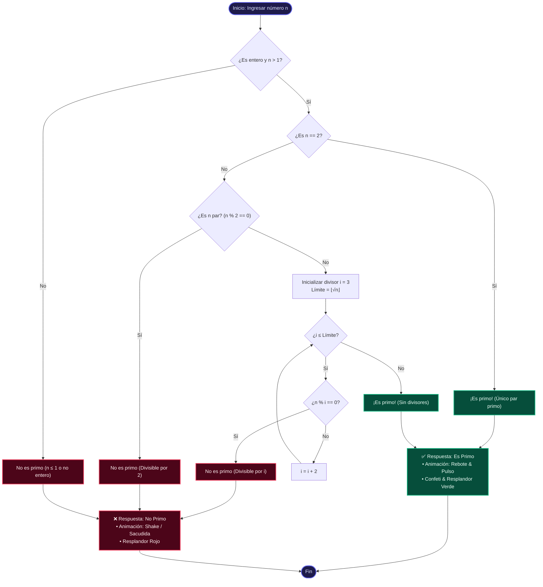

# 🔢 Verificador de Números Primos

Una aplicación web moderna con diseño minimalista (*dark glassmorphism*) y animaciones interactivas diferenciadas según la respuesta: confeti y pulsación luminosa para números primos, y animación de descarte (*shake/tilt*) para números compuestos.

---

## 📌 Algoritmo de Identificación

Para optimizar la verificación, el algoritmo sigue el método de primalidad con comprobación hasta la raíz cuadrada $\mathcal{O}(\sqrt{n})$.

### 📊 Diagrama de Flujo (GitHub Mermaid)



---

## 📝 Pseudocódigo

```pascal
Función EsNumeroPrimo(n):
    Si n no es entero O n <= 1 Entonces:
        Retornar Falso ("Números primos deben ser enteros > 1")
    Fin Si

    Si n == 2 Entonces:
        Retornar Verdadero ("El 2 es el único primo par")
    Fin Si

    Si n % 2 == 0 Entonces:
        Retornar Falso ("Divisible por 2")
    Fin Si

    limite ← RedondearAbajo(RaizCuadrada(n))

    Para i desde 3 hasta limite con paso 2 Hacer:
        Si n % i == 0 Entonces:
            Retornar Falso ("Divisible por " + i)
        Fin Si
    Fin Para

    Retornar Verdadero ("Solo divisible por 1 y por sí mismo")
Fin Función
```

---

## ✨ Características de la Aplicación

- **Minimalismo & Estética Dark:** Fondo ambiental dinámico con desenfoques gaussianos (*backdrop blur*).
- **Animaciones diferenciadas:**
  - 🟢 **Primo:** Efecto *pop-in* elástico, halo luminoso en verde esmeralda y explosión de confeti.
  - 🔴 **No Primo:** Animación de vibración/sacudida (*shake/tilt*) en rojo carmesí con detalle del divisor.
- **Microinteracciones:** Accesos directos con ejemplos rápidos y validación en tiempo real.
- **Sin dependencias pesadas:** HTML, CSS nativo y JavaScript vanilla (con `canvas-confetti` vía CDN).

---

## 🚀 Cómo Ejecutarlo

1. Clona este repositorio o descarga el archivo `index.html`.
2. Haz doble clic en `index.html` para abrirlo en cualquier navegador web moderno.
3. ¡Listo! No requiere servidores ni instalaciones adicionales.
